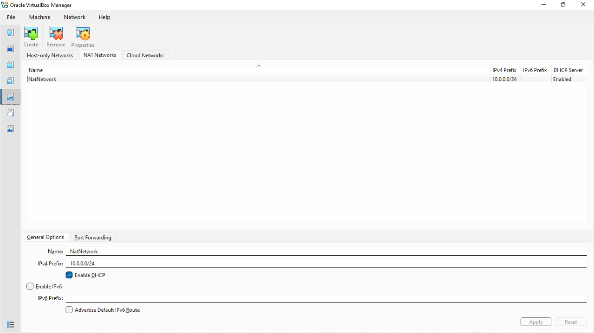
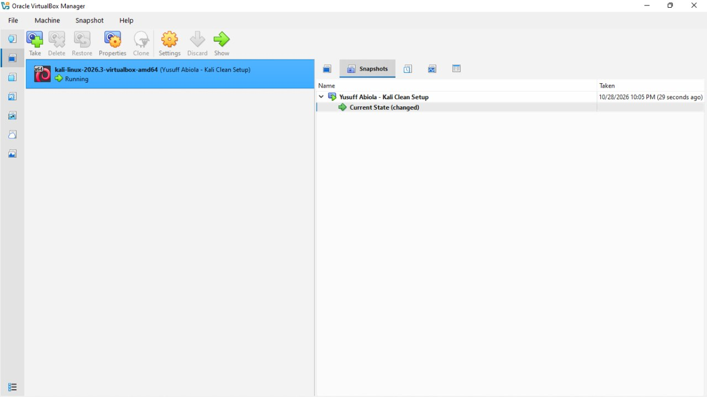
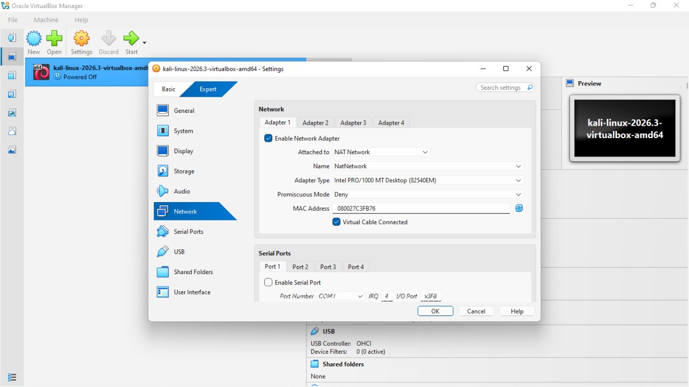
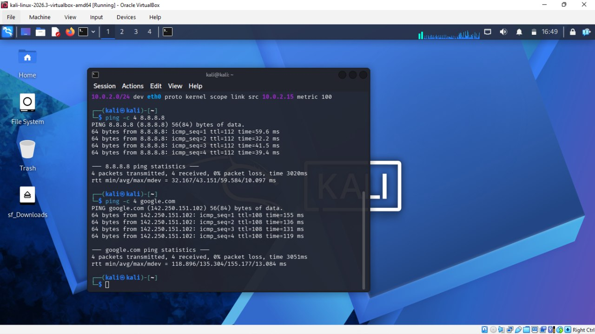
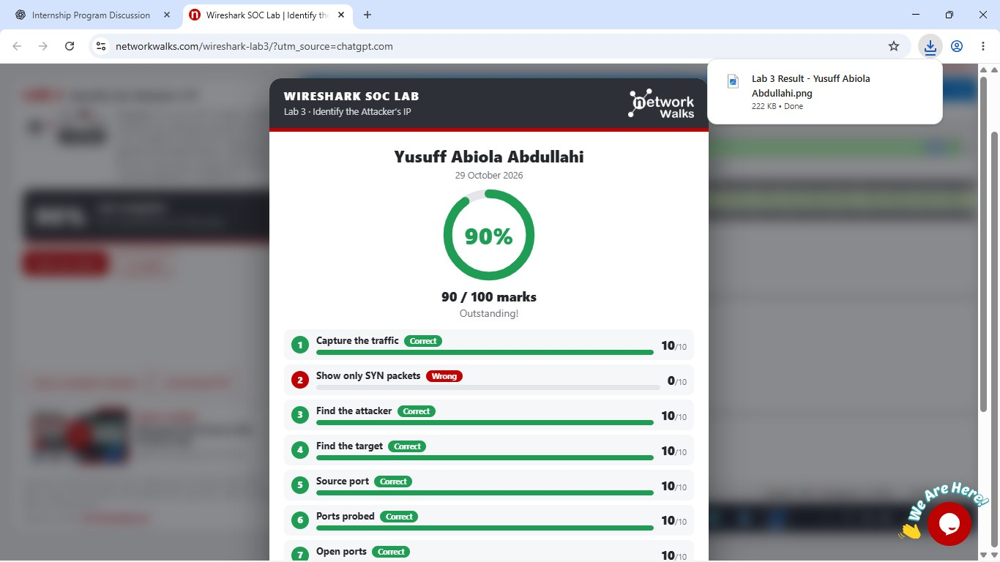
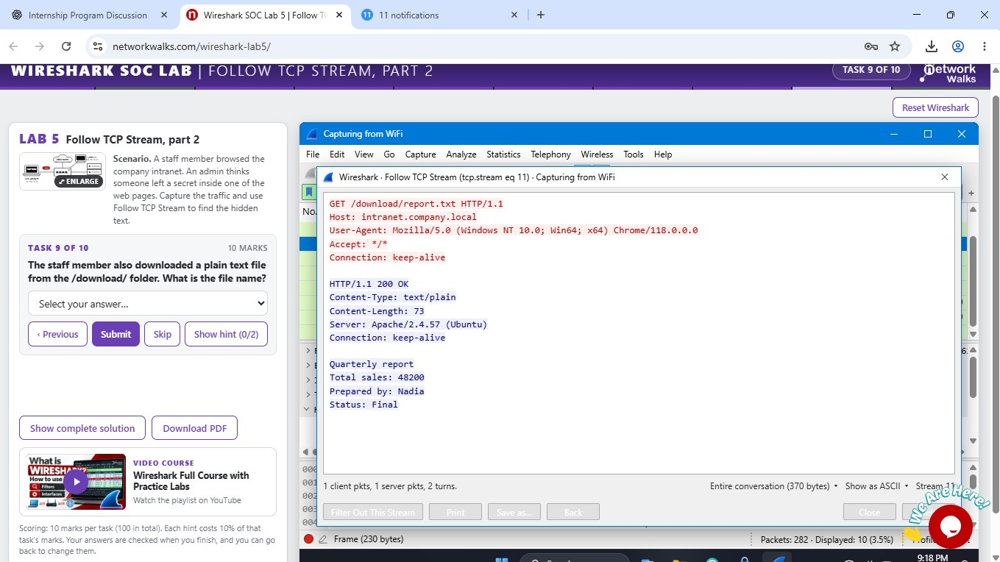
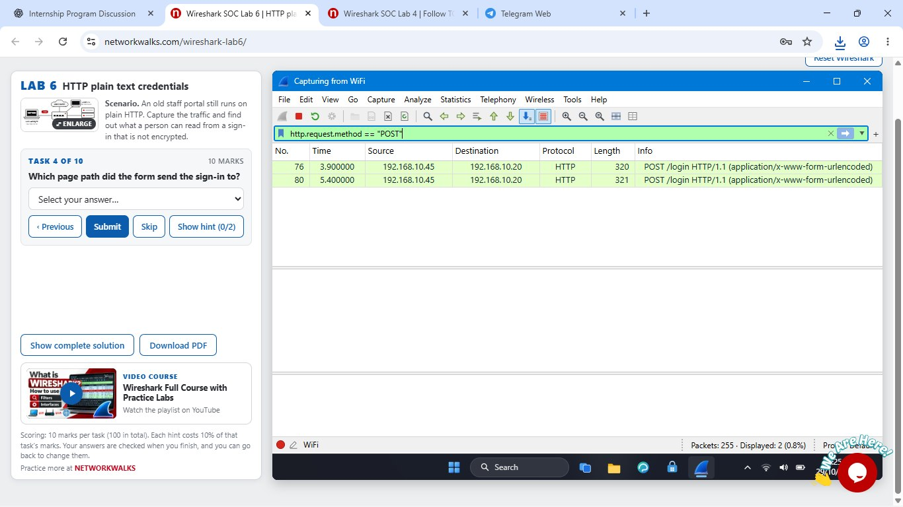
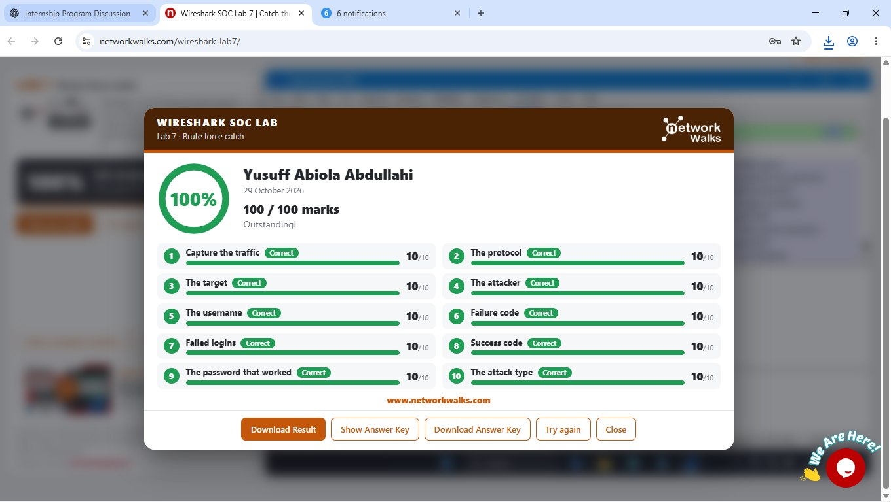
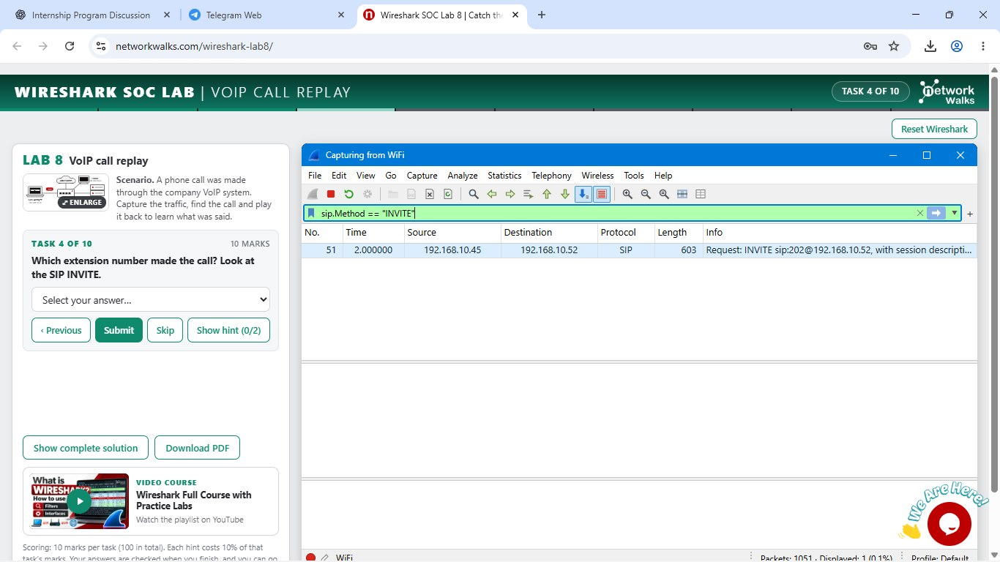

# Networkwalks B084 — Week 1 Cybersecurity Lab

**Cybersecurity Internship Project | Networkwalks | Batch B084**

**Author:** Yusuff Abiola Abdullahi  
**Focus:** Network Security, Traffic Analysis and SOC Investigation

---

## Project Overview

This repository documents my Week 1 practical cybersecurity project completed as part of the Networkwalks Cybersecurity Internship.

The project combined the deployment of a Kali Linux virtual lab environment with practical Wireshark-based network traffic investigations. The exercises simulated common SOC and network-security scenarios including reconnaissance, TCP stream analysis, plaintext credential exposure, brute-force attacks and VoIP traffic analysis.

All traffic analysis activities were performed within authorised training environments provided for the internship.

---

## Objectives

The main objectives of the project were to:

- Configure Kali Linux in an isolated virtualised environment.
- Verify network connectivity and virtual network configuration.
- Develop practical Wireshark packet-analysis skills.
- Identify suspicious hosts and network behaviour.
- Analyse TCP conversations and application-layer traffic.
- Investigate plaintext credential exposure.
- Detect brute-force authentication activity.
- Analyse SIP and RTP traffic used in VoIP communications.
- Translate packet-level observations into security findings and recommendations.

---

## Lab Environment

| Component | Configuration |
|---|---|
| Host Operating System | Windows 11 Pro |
| Virtualisation Platform | Oracle VirtualBox |
| Guest Operating System | Kali Linux 2026.3 |
| Kali Interface | eth0 |
| Kali IPv4 Address | 10.0.2.15/24 |
| Network Mode | VirtualBox NAT Network |
| Network Analysis | Wireshark training environment |

A VirtualBox NAT network with DHCP was configured for the virtual machine. Connectivity from Kali Linux was verified by successfully reaching both `8.8.8.8` and `google.com`.



*Figure 1 — VirtualBox NAT Network configuration with DHCP enabled for the Kali Linux virtual lab.*


*Figure 2 — Clean Kali Linux VirtualBox snapshot created after completing the initial virtual lab setup.*


*Figure 3 — Kali Linux virtual machine network adapter configured to use the VirtualBox NAT Network.*


*Figure 4 — Kali Linux network connectivity verification showing the eth0 IPv4 address and successful ICMP tests to 8.8.8.8 and google.com.*

---

## Tools and Technologies

- Kali Linux
- Oracle VirtualBox
- Wireshark
- TCP/IP
- HTTP
- FTP
- SIP
- RTP
- GitHub

---

# Wireshark SOC Investigations

## Lab 3 — Identifying the Attacker

The first investigation focused on detecting reconnaissance activity within a packet capture.

A TCP SYN filter was used to identify connection attempts:

```text
tcp.flags.syn == 1 && tcp.flags.ack == 0
```

Further filtering isolated traffic originating from the suspected attacker:

```text
ip.src == 192.168.10.66 && tcp.flags.syn == 1 && tcp.flags.ack == 0
```

### Findings

- **Attacker IP:** `192.168.10.66`
- **Target IP:** `192.168.10.20`
- **Attacker source port:** `52311`
- **Ports probed:** 40
- **Open ports identified:** `22`, `80`, `443`
- **Observed behaviour:** TCP SYN port scanning

The traffic pattern demonstrated reconnaissance against multiple ports on the target system.

---



*Figure 5 — Lab 3 investigation result demonstrating successful identification of the attacker, target, source port, probed ports and exposed services during TCP SYN reconnaissance analysis.*

---

## Lab 4 – TCP Stream Analysis
## Lab 4 — TCP Stream Analysis

This exercise focused on reconstructing TCP conversations using Wireshark's **Follow TCP Stream** functionality.

The investigation demonstrated how individual packets can be reconstructed into an application-layer conversation, making it easier for an analyst to understand the information exchanged between systems.

---

## Lab 5 — Hidden Information in TCP Traffic

HTTP traffic was examined using **Follow TCP Stream** to investigate information transmitted by an internal web application.

A hidden HTML comment revealed sensitive information:

```text
IT note: backup server is 192.168.10.77,
access code Falcon-9921.
Remove before publishing.
```

### Findings

- **Backup server:** `192.168.10.77`
- **Exposed access code:** `Falcon-9921`
- Information was exposed inside an **HTML comment**.
- The HTTP response returned **200 OK**.
- A plaintext file named `report.txt` was also observed being downloaded.

This demonstrated that information hidden from the visible webpage can still be transmitted to the client and recovered through network analysis.



*Figure 6 — Follow TCP Stream analysis showing the plaintext `report.txt` file recovered from HTTP traffic, including the HTTP 200 OK response and transmitted report contents.*

---

## Lab 6 — HTTP Plaintext Credential Exposure

The next investigation examined authentication traffic from a legacy staff portal operating over HTTP.

The following filter isolated login requests:

```text
http.request.method == "POST"
```

### Findings

- **Protocol:** HTTP
- **Method:** POST
- **Login path:** `/login`
- **Client IP:** `192.168.10.45`
- **Destination:** `192.168.10.20`
- The login form was submitted twice.
- Form information was visible under **HTML Form URL Encoded**.

Because HTTP does not provide transport encryption, authentication information can be exposed to anyone capable of capturing the traffic.

**Recommended mitigation:** Use HTTPS/TLS for authentication and sensitive web traffic.



*Figure 7 — Wireshark HTTP analysis using the `http.request.method == "POST"` display filter, showing two plaintext login requests from `192.168.10.45` to `192.168.10.20` through the `/login` endpoint.*

---

## Lab 7 — FTP Brute-Force Investigation

FTP traffic was analysed after repeated failed authentication attempts were detected against an FTP server.

### Findings

- **Protocol:** FTP
- **Target server:** `192.168.10.20`
- **Attacker:** `192.168.10.66`
- **Username targeted:** `admin`
- **Failed authentication response:** `530`
- **Successful authentication response:** `230`
- **Attack type:** Brute-force attack

The packet capture contained repeated `USER` and `PASS` commands, demonstrating how plaintext FTP traffic can expose authentication attempts during network monitoring.

### Security Recommendations

- Replace plaintext FTP with SFTP or FTPS where appropriate.
- Apply login rate limiting or account lockout controls.
- Monitor repeated authentication failures.
- Use stronger authentication controls where possible.

- 

*Figure 8 — Lab 7 FTP brute-force investigation result showing successful completion of all investigation tasks, including identification of the target, attacker, username, failed authentication attempts, successful authentication response and brute-force attack type.*

---

## Lab 8 — VoIP Traffic Analysis

The final investigation examined a VoIP telephone conversation.

SIP traffic was used to identify the call setup:

```text
sip.Method == "INVITE"
```

RTP traffic was then analysed to identify the media stream.

### Findings

- **Call signalling protocol:** SIP
- **Media protocol:** RTP
- **Caller IP:** `192.168.10.45`
- **Receiver IP:** `192.168.10.52`
- **Calling extension:** `101`
- **Called extension:** `202`
- **Audio codec:** G.711 PCMU

The exercise demonstrated that unencrypted VoIP traffic may expose call metadata and potentially allow captured audio to be reconstructed.

**Recommended mitigation:** Protect VoIP communications using encrypted signalling and **SRTP** for media.



*Figure 9 — Wireshark VoIP investigation using the `sip.Method == "INVITE"` display filter to identify SIP call setup traffic from `192.168.10.45` to `192.168.10.52`, forming part of the analysis of the VoIP call between extensions `101` and `202`.*

---

# Key Security Findings

The investigations demonstrated several important security principles:

1. **Reconnaissance leaves detectable network indicators.** TCP SYN patterns can reveal port-scanning activity.
2. **Sensitive information should never be embedded in client-delivered content.** HTML comments can still be inspected or captured.
3. **HTTP authentication without TLS exposes sensitive information.**
4. **Plaintext protocols such as FTP create unnecessary credential exposure.**
5. **Repeated authentication failures are useful indicators of brute-force attacks.**
6. **Unencrypted VoIP traffic can expose signalling information and media streams.**

---

## Skills Demonstrated

Through this project, I developed practical experience in:

- Network traffic analysis
- Wireshark display filtering
- TCP flag analysis
- IP address and port investigation
- TCP stream reconstruction
- HTTP request analysis
- Plaintext credential exposure analysis
- FTP authentication analysis
- Brute-force attack detection
- SIP signalling analysis
- RTP media analysis
- VoIP codec identification
- Virtual machine networking
- Kali Linux administration
- Translating technical findings into security recommendations

---

## Project Evidence

Screenshots demonstrating the virtual lab configuration and Wireshark investigations are available in the [`screenshots`](./screenshots/) directory.

Evidence includes:

- VirtualBox NAT network configuration
- Kali Linux virtual machine network settings
- Kali Linux environment
- Successful external connectivity tests
- Attacker identification investigation
- TCP stream analysis
- HTTP POST traffic analysis
- FTP brute-force investigation results
- SIP/VoIP traffic analysis

---

## Full Documentation

The complete Week 1 project report, including additional explanations and supporting evidence, is available here:

[`Week1_Cybersecurity_Report_Yusuff_Abiola.docx`](./documentation/Week1_Cybersecurity_Report_Yusuff_Abiola.docx)

---

## Conclusion

This Week 1 project strengthened my understanding of how network traffic can be used to identify security incidents and reconstruct activity occurring across a network.

By combining Kali Linux, virtualisation and Wireshark-based investigations, I gained practical exposure to reconnaissance detection, TCP stream analysis, insecure web authentication, FTP brute-force activity and VoIP traffic analysis.

The project also reinforced the importance of encryption, secure authentication protocols, network monitoring and careful handling of sensitive information.

---

**Yusuff Abiola Abdullahi**  
Cybersecurity Student | Network Security & Networking
